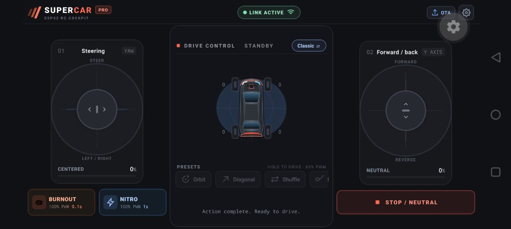

# Super Car Remote — ESP32 RC Cockpit 🏎️💨

A high-performance React Native (Expo SDK 58) controller application engineered for the **ESP32 Super Car**. Features dual-thumb multi-touch joysticks, dynamic 4-wheel telemetry, non-blocking action triggers, and persistent drive-mode memory.

---

## 📸 App Preview



---

## ✨ Features

### 🎮 Dedicated Landscape Cockpit Console
* **Ergonomic Handheld Transmitter Layout**: Locked in landscape orientation with dual-wing cockpit controls tailored for thumb gameplay.
* **Notch & Status Bar Adaptive**: Dynamically applies safe-area insets (`insets.left`, `insets.right`) and suppresses status-bar overlap for an immersive edge-to-edge experience.

### ⚡ True Multi-Touch Gesture Recognizers
* **Powered by `react-native-gesture-handler`**: Bypasses React Native's singleton responder lock.
* **Simultaneous Gesture Orchestration**: Steer with your left thumb, control throttle/strafe with your right thumb, and hold **Burnout** or **Nitro** with a third finger simultaneously without any input drops or cancellation (`simultaneousWithExternalGesture`).
* **Zero Threshold Activation**: Configured with `minDistance(0)` and `shouldCancelWhenOutside(false)` for instant, continuous tracking across the screen.

### 💾 Persistent Local Storage
* **Remembers Drive Mode**: Automatically persists and restores your selected driving mode (**Classic ⇄ Mecanum**) across app restarts using `@react-native-async-storage/async-storage`.
* **Configurable Gateway**: Remembers custom ESP32 server IPs and Live/Demo preferences.

### 🏎️ Dynamic Chassis Telemetry & Underglow
* **Live 4-Wheel Motor PWM**: Real-time readout for all 4 independent motors (**M1** Left-Front, **M2** Right-Front, **M3** Left-Rear, **M4** Right-Rear).
* **Reactive Underglow Lighting**:
  * 🩵 **Electric Cyan**: Normal driving & turning.
  * 🧡 **Flame Orange**: During **Burnout** with animated exhaust flame flicker.
  * ⚡ **Hyper Cyan / Blue**: During **Nitro Boost**.
* **Dynamic Chassis Kinematics**: Chassis tilts and shifts laterally based on commanded yaw and strafe vectors.

### 🚀 Racing Action Deck & Presets
* **BURNOUT**: 100% PWM forward surge across all 4 wheels for 0.1s with active countdown timer.
* **NITRO BOOST**: 100% PWM boost across all 4 wheels for 1.0s with depleting progress fill.
* **Quick Moves (Hold to Drive · 80% PWM)**:
  * 🔄 **Orbit**: Side strafe + yaw rotation
  * ↗️ **Diagonal Dash**: 45° planar vector
  * ⇄ **Side Shuffle**: Oscillating lateral wave
  * ♾️ **Figure Eight**: Continuous flowing turns
  * 📍 **Corner Pivot**: Rear-right chassis pivot
  * 💃 **Dance**: Sway + rotation choreography
* **Emergency Stop / Neutral**: Instant multi-touch neutral lock that stops all motors in <10ms.

### 📡 Wireless Telemetry & OTA Firmware Update
* **100 Hz Control Link**: Optimized low-latency HTTP transport with consecutive error dampening against Wi-Fi AP jitter.
* **In-App OTA Flasher**: Binary header validation (`0xabcd5432` magic check), upload progress feedback, and reboot confirmation over ESP32 Wi-Fi.
* **Interactive Demo Mode**: Full offline simulation mode for testing controls without hardware.

---

## 🛠️ Tech Stack

* **Framework**: React Native 0.88 / Expo SDK 58 (Expo Router)
* **Gestures**: `react-native-gesture-handler` v3
* **Animations**: `react-native-reanimated` & React Native Animated
* **Vector Graphics**: `react-native-svg`
* **Storage**: `@react-native-async-storage/async-storage`
* **Language**: TypeScript (Strict Mode)

---

## 🚀 Getting Started

### Prerequisites
* Node.js 18+
* Expo CLI (`npx expo`)

### Installation

```bash
# Navigate to the app directory
cd remote-app

# Install dependencies
npm install
```

### Running the App

```bash
# Start Expo development server
npx expo start

# Run in Web Browser
npm run web

# Run on Android (Expo Go or connected USB device)
npm run android

# Run on iOS
npm run ios
```

---

## 🧪 Verification & Testing

Run the automated test suite to verify motor mixing mathematics, action timers, firmware validation, transport serialization, and storage persistence:

```bash
npm test
```

Test coverage includes:
1. Motor Output & PWM Mixing (Deadband, Deadzone, 4-wheel formulas)
2. Action Outputs (Burnout & Nitro 100% PWM overrides)
3. Quick Moves Presets (80% PWM limits)
4. Firmware OTA Binary Validation
5. Transport Serialization & Seq Counter Logic
6. Orientation & Screen Inset Sizing
7. Drive Mode LocalStorage Persistence
